<div align="center">

# 🐾 Find My Dog

### Your pet is missing. Every camera on your street already filmed the answer.

**An opt-in, owner-initiated search engine for neighbourhood camera footage, built on SAM 3.1 and Muse Spark.**

[](https://github.com/shahaman098/find-my-dog/actions/workflows/ci.yml)
[](https://find-my-dog.kiritokris.workers.dev)
[](#-the-meta-stack)
[](evidence/logs/unit-tests.txt)
[](evidence/logs/access-control-real.txt)
[](LICENSE)

**[▶ Live demo](https://find-my-dog.kiritokris.workers.dev/#/demo)** ·
**[📊 Evidence pack](EVIDENCE.md)** ·
**[🧠 Every prompt and tool](worker/src/prompts.ts)** ·
**[⚙️ The pipeline](worker/src/index.ts)** ·
**[🎤 Pitch + Q&A](PITCH.md)**

*Meta Global AI Developer Hackathon 2026 · Problem statement: **"Build for Your World"***

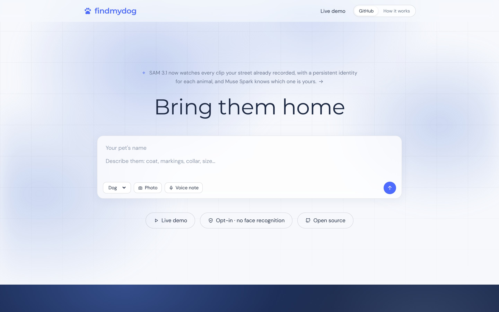

</div>

---

## ⚡ Judges: the 60-second version

1. **Open the [live demo](https://find-my-dog.kiritokris.workers.dev/#/demo).** It's a real report with SAM 3.1 tracks, Spark verdicts, a plan and a poster. It's read-only, so nobody can vandalise it.
2. **Look at the numbers below.** Every one was measured on the live Meta API through the production code path, and each links to its raw data.
3. **Open [`worker/src/prompts.ts`](worker/src/prompts.ts)** for every prompt, schema and tool, and **[`worker/src/index.ts`](worker/src/index.ts)** for the pipeline.

| | Measured on real models | Proof |
|---|---|---|
| 🥇 | The owner's pet was the **#1-ranked candidate 9 / 9 times**, against deliberate look-alike dogs | [`match.json`](eval/results/match.json) |
| 🎯 | **92 % accuracy** over 87 verdicts, **93 % recall**, 83 % precision *before* the owner confirms | [`match_rows.csv`](evidence/data/match_rows.csv) |
| 🌙 | Still **#1 in 15 / 15** degraded case-conditions (night-vision IR, ¼ resolution, motion blur, dusk, all combined), 18 / 18 with the clean baseline | [`robust_*.json`](eval/results) |
| 🫥 | SAM 3.1 kept the **same track ID through a 1.5 s full-frame blackout** | [`doorcam_occluded.tracks.json`](eval/results/doorcam_occluded.tracks.json) |
| 🔍 | SAM found a dog of **≈ 50 × 50 px (0.3 % of the frame)** on a real doorbell, among adults, a child and a stroller: **0 tracks on people** | [`doorcam.tracks.json`](eval/results/doorcam.tracks.json) |
| 🙅 | A person SAM mislabelled as "dog" was **rejected 9 / 9 times**. No person is ever confirmed as a pet | [`match.json`](eval/results/match.json) |
| 🖥️ | **21 / 21** Spark verdicts correct through the real UI across 3 runs (7 / 7 in the run whose full state is kept in the repo), with plan and poster generated live | [`real_ui_state.json`](evidence/real_ui_state.json) |
| 🤖 | The coordinator is a **real tool loop**: Spark chose `suggest_next_search` → `make_poster` itself | [`plan.json`](eval/results/plan.json) |
| 🔐 | **12 / 12** access-control checks pass on the real-mode Worker | [log](evidence/logs/access-control-real.txt) |
| 🌐 | The **deployed site passes the full end-to-end test in real mode** | [log](evidence/logs/e2e-production.txt) |
| 💸 | **≈ $3 per one-hour neighbourhood search**, shown live by the in-app cost meter | [`cost.ts`](worker/src/cost.ts) |

<picture>
  <source media="(prefers-color-scheme: dark)" srcset="evidence/img/chart-headline-dark.png">
  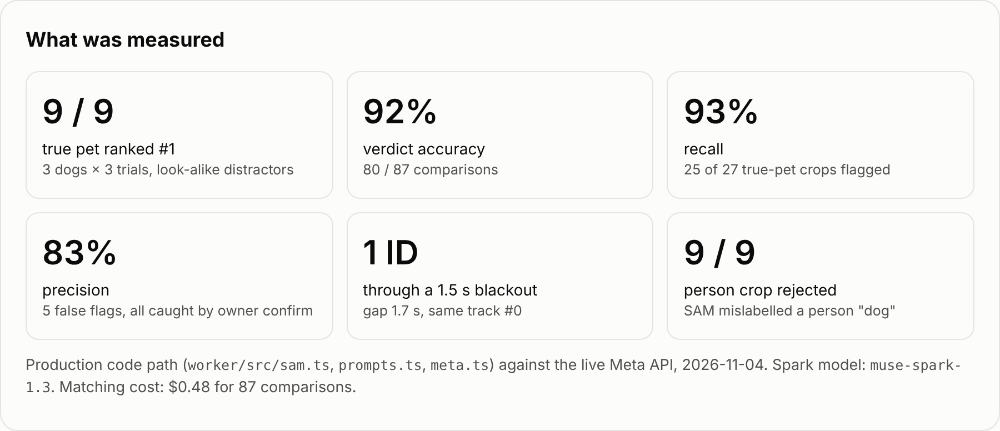
</picture>

---

## Contents

[The problem](#-the-problem) · [How it works](#-how-it-works) · [The Meta stack](#-the-meta-stack) · [See it run](#-see-it-run-on-real-models) · [Design](#-designed-for-a-worried-owner) · [Results](#-results) · [Privacy](#-privacy-and-access-control) · [Why not Ring?](#-why-not-just-ring-search-party) · [Architecture](#-architecture) · [Unit economics](#-unit-economics) · [Bugs we caught](#-bugs-the-evidence-exposed-all-fixed) · [Limitations](#-limitations-read-before-quoting-the-numbers) · [Run it](#-run-it) · [Reproduce](#-reproduce-every-number) · [Judging criteria](#-how-this-meets-the-judging-criteria) · [Author](#-author)

---

## 🐕 The problem

About **10 million pets go missing in the US every year** (industry estimate). In the ASPCA's 2012 national survey,
**93 % of lost dogs were recovered**, and searching the neighbourhood was the most common way owners found them
(**49 %**). That search is still done on foot, by memory, knocking on doors.

Meanwhile, almost every street already has doorbell cameras, home CCTV and dashcams that **recorded the pet walking
past**. Nobody knows it yet, the clips are spread across a dozen brands, and nobody has time to scrub hours of video.

**Find My Dog turns that footage into a search party.**

## 🧭 How it works

| Step | Who | What happens |
|:---:|---|---|
| **1** | Owner | Files a report: name, photo, description and an optional **voice note** (*Muse Voice Transcribe* turns it into the search brief). Gets a private **owner token**. |
| **2** | Neighbours | Open the neighbour link and **upload clips from any camera**: Ring exports, Nest, CCTV, dashcams, phones. Neighbours can *only* add. |
| **3** | SAM 3.1 | **Tracks every animal in every clip with a persistent identity**, with exact timestamps per frame. |
| **4** | Muse Spark | **Compares each tracked animal with the owner's photo**, returns a structured verdict with its reasons, and ranks the candidates. |
| **5** | Owner | **Confirms or rejects every candidate.** The model never confirms a sighting by itself. |
| **6** | Spark tool loop | Reads the confirmed sightings, **decides** to call `suggest_next_search` (where to look next, and why) and `make_poster` (*Muse Image*). |
| **7** | The street | Gets a **share page**: a sighting timeline, the next-search plan, the owner's real photo next to the generated poster, and the cost meter. |

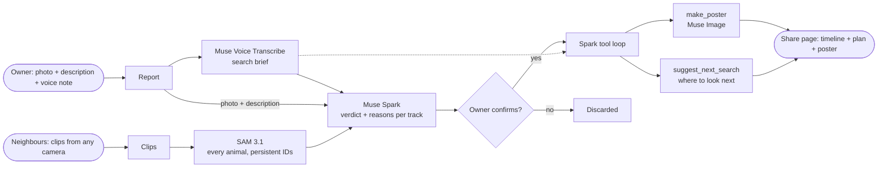

> **Output:** not a "possible match" ping, but an **evidence-linked sighting timeline, a concrete next-search plan, and a printable alert poster.**

## 🧠 The Meta stack

**All runtime models are Meta models.** Each one does a job the others can't.

| Step | Model | Why it carries real weight |
|---|---|---|
| Track every animal with persistent IDs | **SAM 3.1** | Text-prompted concept tracking across frames. Our parser for its streamed `<Nf>id<\|box…\|>` grammar is in [`sam.ts`](worker/src/sam.ts) |
| Match owner photo ↔ track stills | **Muse Spark 1.3** (or **Muse Glimmer** open weights on Baseten, with automatic fallback to Spark) | Appearance-attribute reasoning, strict `json_schema` output, rationale shown to the owner |
| Voice note → search brief | **Muse Voice Transcribe** | Diarised transcript of the owner's report |
| Alert poster | **Muse Image** | Generated *inside* Spark's tool loop |
| Search coordination | **Spark tool loop** | Spark decides which tools to run and in what order. It's not a hard-coded chain |

## 🎬 See it run on real models

Every verdict, rationale, plan and poster below was produced **live by SAM 3.1, Muse Spark and Muse Image** on
4 Nov, through the product UI ([`capture_real_ui.cjs`](evidence/capture_real_ui.cjs)). Nothing is mocked.

> **Shown in the current UI.** After the redesign, that recorded run ([`real_ui_state.json`](evidence/real_ui_state.json))
> was replayed into a local Worker by [`replay_real_ui.py`](evidence/replay_real_ui.py), and the same capture script
> photographed it. No model was called during the replay, and the outputs are unchanged: the replayed state matches the
> recording field for field. Only the owner's confirm and reject clicks were made again.

<table>
<tr>
<td width="50%" valign="top">

**① Footage in, SAM 3.1 tracks out.** One card per tracked animal, with persistent IDs and timestamps.

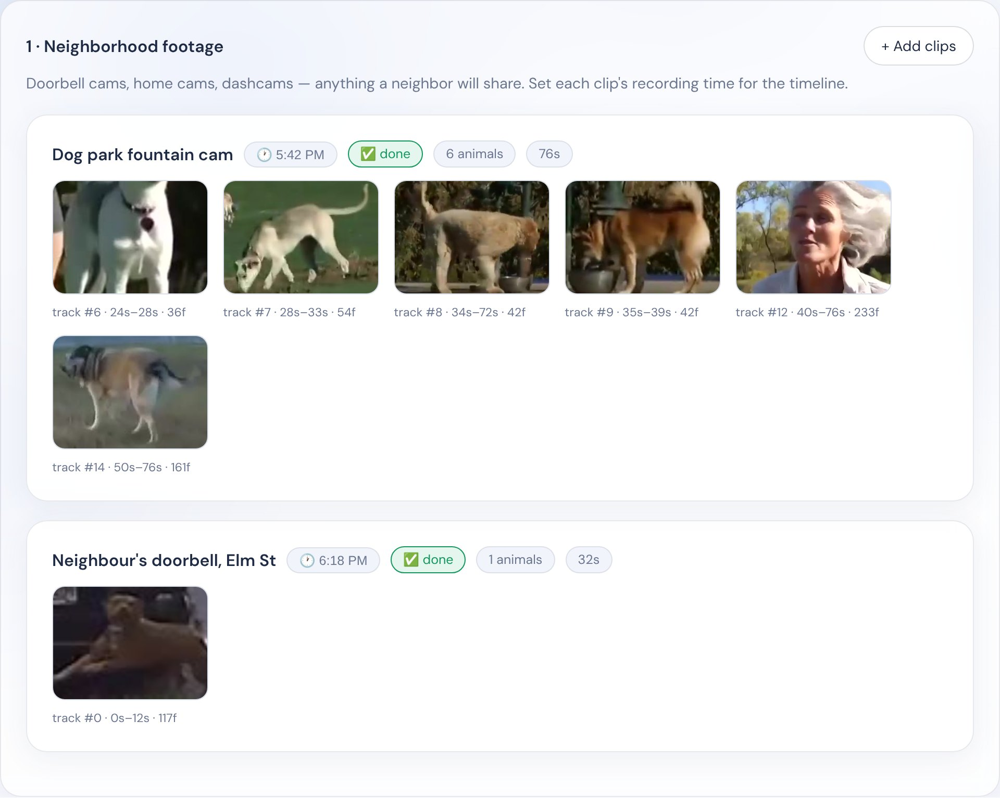

</td>
<td width="50%" valign="top">

**② Spark ranks every animal and explains why.** Biscuit comes first. Four other dogs, a tan dog on a neighbour's doorbell, and the person SAM mislabelled are all rejected, with reasons.

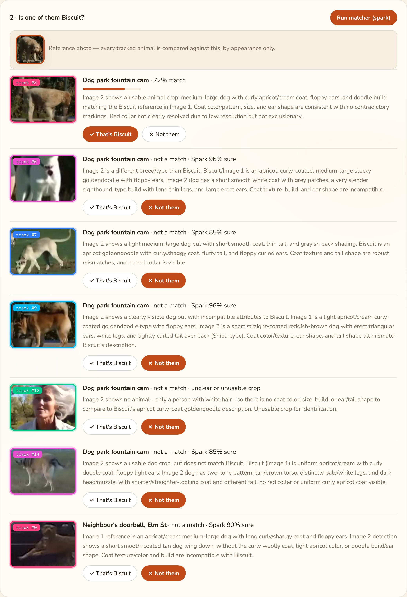

</td>
</tr>
<tr>
<td width="50%" valign="top">

**③ After the owner confirms,** Spark's tool loop writes the next-search plan and calls Muse Image for the poster.

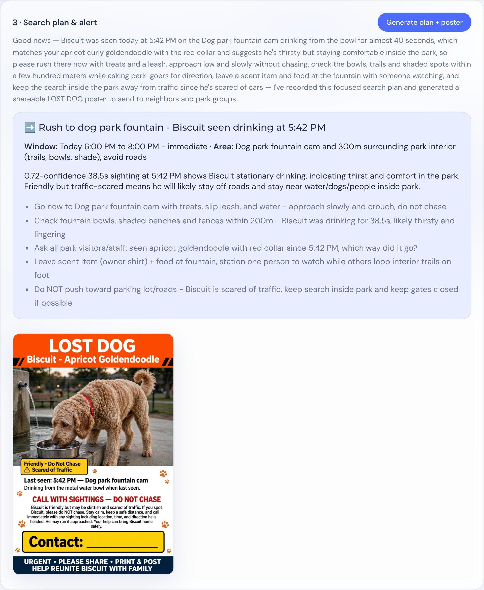

</td>
<td width="50%" valign="top">

**④ The share page for the street:** sighting ribbon, plan, the real photo beside the poster, and the cost meter ($0.06 for this session).

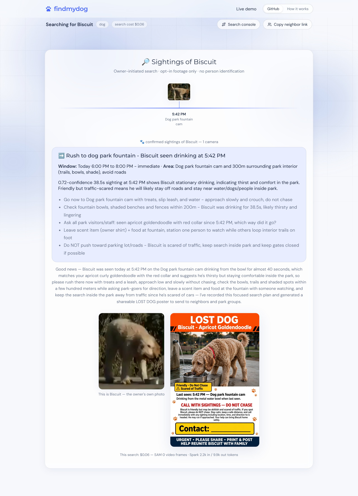

</td>
</tr>
</table>

Full console: [`real-00-console-full.jpg`](evidence/img/real-00-console-full.jpg) · final report state:
[`real_ui_state.json`](evidence/real_ui_state.json) · per-run numbers: [`benchmark-summary.txt`](evidence/logs/benchmark-summary.txt)

## 🎨 Designed for a worried owner

The report form is a **lost-pet poster**: a photo slot, the pet's name, species, a description and a voice note, then
one button. Every tracked animal keeps **one colour across the whole search**, in the style of SAM's own mask
overlays, so "track #8" in the footage is the same pink card in the match list. Light and dark modes and phone
layouts are built in, and buttons meet WCAG AA contrast.

| Light | Dark | Phone |
|---|---|---|
|  | 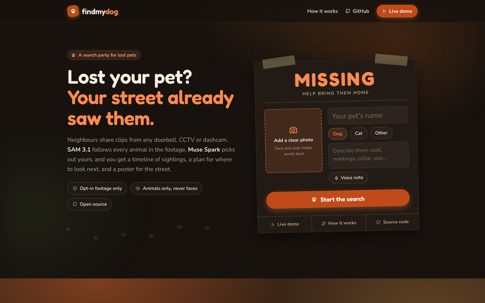 | 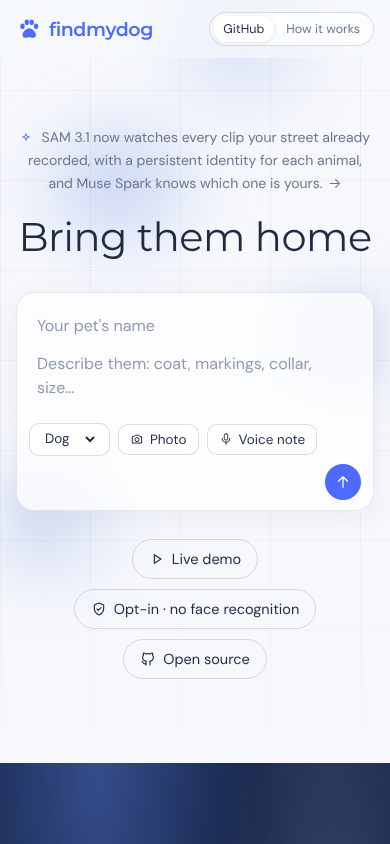 |

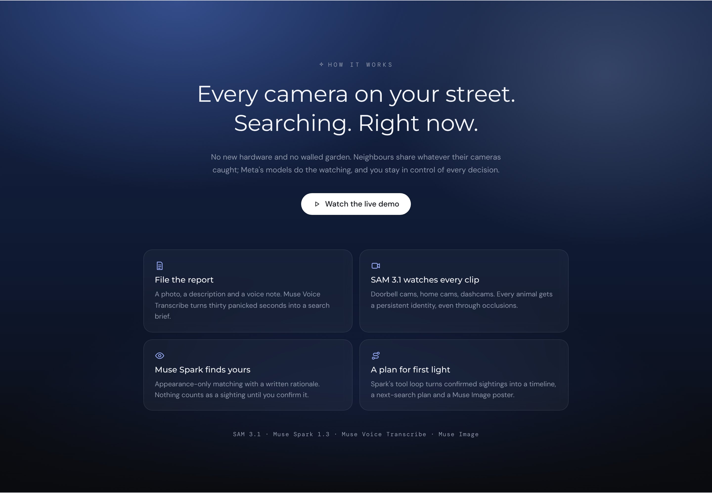

## 📊 Results

Measured on **4 Nov 2026** against the **live Meta API** using **the production code path**:
[`eval/benchmark.ts`](eval/benchmark.ts) imports the Worker's own SAM parser ([`sam.ts`](worker/src/sam.ts)),
prompts ([`prompts.ts`](worker/src/prompts.ts)) and model clients ([`meta.ts`](worker/src/meta.ts)). Charts are
generated from the raw JSON by [`evidence/build.py`](evidence/build.py). **No number is typed in by hand.**
Full write-up with every chart: **[EVIDENCE.md](EVIDENCE.md)**.

**How to read the evidence:**

| Label | Meaning |
|---|---|
| **Real** | Live Meta API through the production code path. All numbers, verdicts, plans and posters in this README |
| **Replayed** | A recorded real run shown again in the current UI, with no model calls ([`replay_real_ui.py`](evidence/replay_real_ui.py)) |
| **Mock** | Deterministic simulation (`FMD_MOCK=1`), used for CI's end-to-end test and the landing-page screenshots (which show no model output). Never used for a quality number |

### 1. Matching: does the owner see the right animal first?

| Metric | Result |
|---|---|
| True pet ranked #1 | **9 / 9** (3 dogs × 3 trials) |
| Verdict accuracy | **92 %** (80 / 87) |
| Recall | **93 %** (25 / 27 true-pet crops flagged) |
| Precision | **83 %** (5 false flags, all 0.55–0.65 strength; every top-ranked true match ≥ 0.75) |
| Person crop rejected | **9 / 9** |
| Cost | **$0.48** for 87 comparisons (≈ $0.0055 each) |

<picture>
  <source media="(prefers-color-scheme: dark)" srcset="evidence/img/chart-strength-dark.png">
  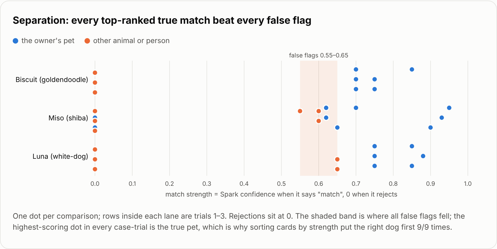
</picture>

**Why 83 % precision is fine here:** cards are sorted by match strength, so a false flag never outranked the real pet,
and **the owner confirms every sighting**. The product never auto-confirms. The threshold trade-off is charted in
[EVIDENCE §1](EVIDENCE.md#1-matching-benchmark-muse-spark).

**How the set was built.** SAM 3.1 tracked every dog in a 76 s dog-park montage (16 tracks). Each case's reference
photo is a crop of one dog. Positives are crops of the same dog later in the same continuous shot. Negatives are the
other dogs, including deliberate look-alikes (a white hound against a white dog, a tan doodle against a shiba), plus
the person SAM mislabelled. Every label was checked by eye: [`match_cases.json`](eval/match_cases.json).

<details>
<summary><b>Every comparison, with the animal it was about (3 cases)</b></summary>

Blue border = the owner's pet. Orange = a different animal or a person. ✓ = Spark agreed with ground truth.

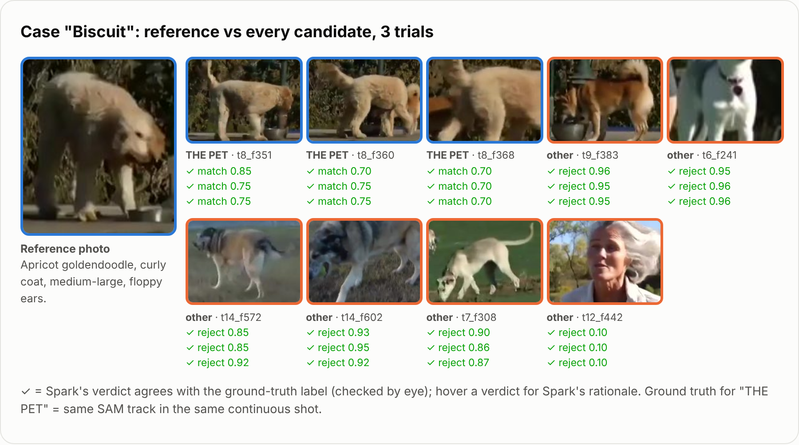
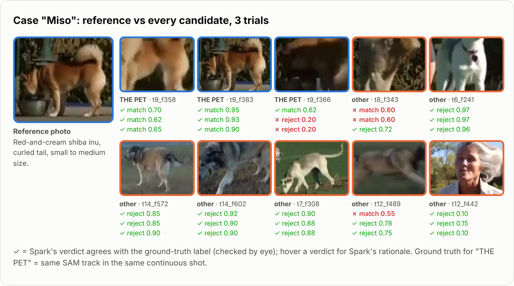
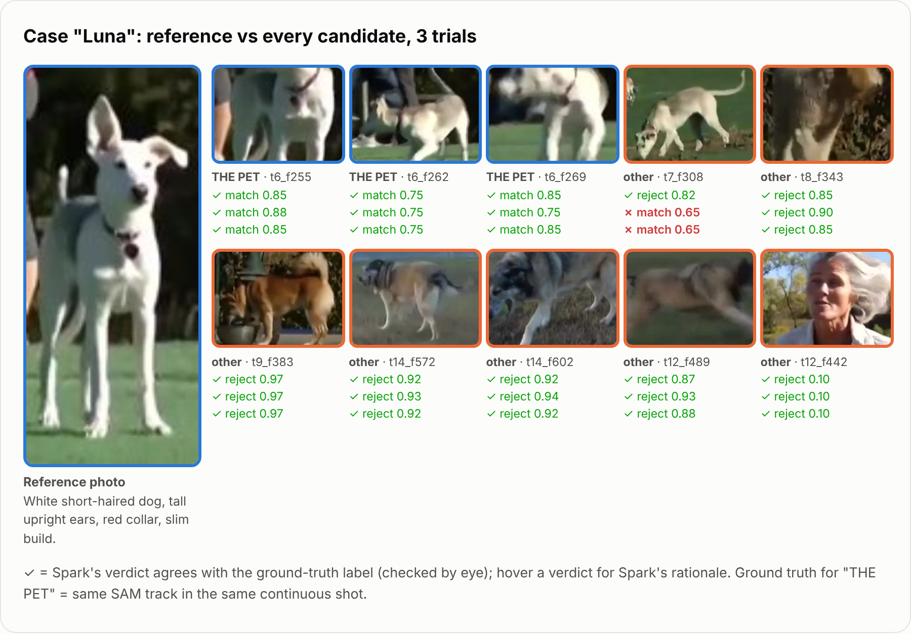

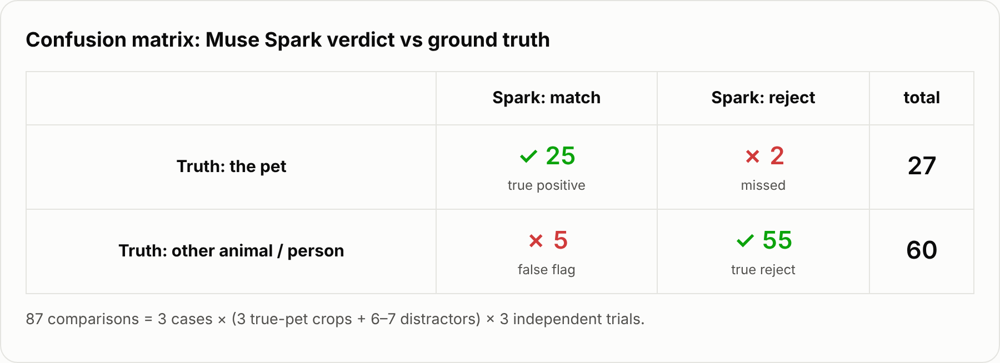

Raw rows, with Spark's full rationale for each verdict: [`evidence/data/match_rows.csv`](evidence/data/match_rows.csv)

</details>

### 2. Robustness: does it hold up in doorbell conditions?

The same 29 labelled comparisons were re-run with the **camera crops** degraded by [`eval/degrade.py`](eval/degrade.py).
The owner's reference photo stays clean, as a phone photo would. 145 calls, $0.87.

| Condition | Accuracy | Precision | Recall | Right dog #1 |
|---|:---:|:---:|:---:|:---:|
| Night-vision IR | 93 % | 89 % | 89 % | ✅ 3 / 3 |
| Distant animal (¼ resolution) | 90 % | 80 % | 89 % | ✅ 3 / 3 |
| Running animal (motion blur) | 90 % | 80 % | 89 % | ✅ 3 / 3 |
| Dusk, no IR | 93 % | 89 % | 89 % | ✅ 3 / 3 |
| **Worst case** (IR + ¼ res + blur) | 86 % | 86 % | **67 %** | ✅ 3 / 3 |

<picture>
  <source media="(prefers-color-scheme: dark)" srcset="evidence/img/chart-robustness-dark.png">
  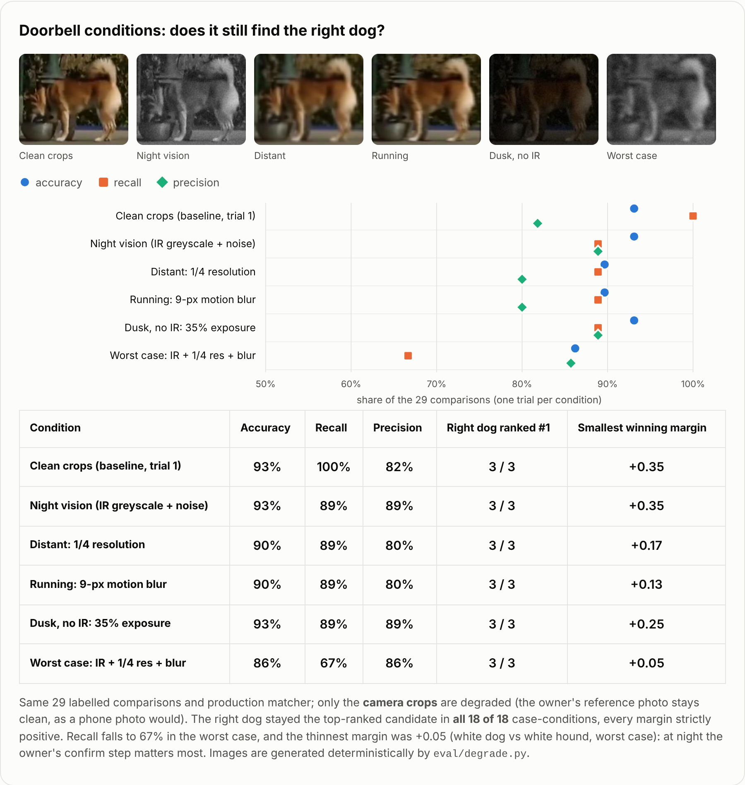
</picture>

Raw rows: [`evidence/data/robustness_rows.csv`](evidence/data/robustness_rows.csv)

### 3. Tracking: does SAM 3.1 keep the identity?

| Test | Result |
|---|---|
| Small dog on a real doorbell camera | One continuous track for **12.3 s**, about **50 × 50 px (0.3 % of the frame)**, **0 tracks on people** |
| Same clip, whole frame blacked out 4.0–5.5 s | **Same track #0** afterwards: 1 track, 1 gap of 1.7 s, no new ID |
| Cost | **$0.20 per 1,000 frames** |

<table>
<tr>
<td width="45%">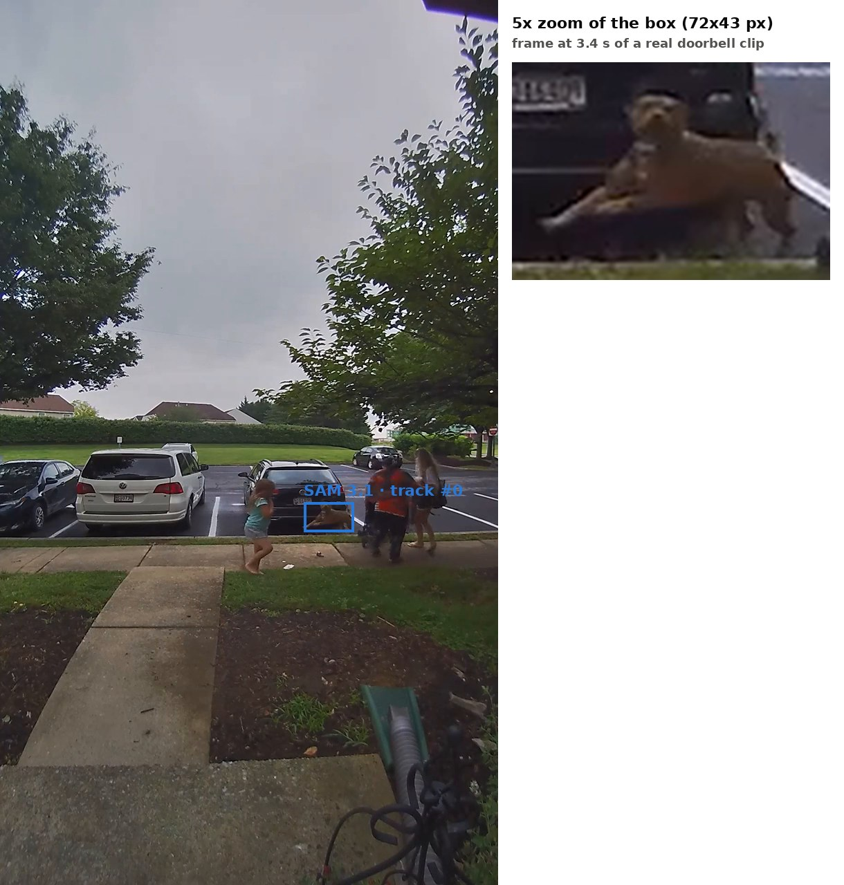</td>
<td width="55%">
<picture>
  <source media="(prefers-color-scheme: dark)" srcset="evidence/img/chart-sam-occlusion-dark.png">
  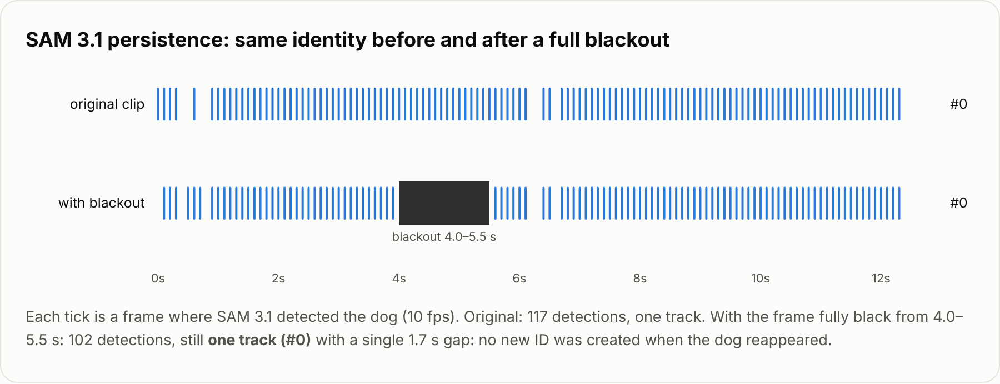
</picture>
</td>
</tr>
</table>

All tracks: [`evidence/data/sam_tracks.csv`](evidence/data/sam_tracks.csv) · raw: [`eval/results/*.tracks.json`](eval/results)

### 4. End to end

| Check | Result | Log |
|---|---|---|
| Deployed site, **real mode**: report → clip → SAM tracks → Spark match → confirm → plan → Muse Image poster, and the demo stays read-only | **PASS** ($0.04) | [`e2e-production.txt`](evidence/logs/e2e-production.txt) |
| Real models through the UI, 3 separate runs × 7 candidates | **21 / 21** verdicts correct (the kept run: 7 / 7) | [EVIDENCE §3](EVIDENCE.md#3-the-product-running-on-real-models) |
| Full pipeline + access model (mock mode, also in CI) | **PASS** | [`e2e-mock.txt`](evidence/logs/e2e-mock.txt) |
| Strict TypeScript over the Worker | exit 0 | [`typecheck.txt`](evidence/logs/typecheck.txt) |
| Unit tests (SAM grammar, track merge, clock order, cost meter, image sniffing, public-URL check) | **12 / 12** | [`unit-tests.txt`](evidence/logs/unit-tests.txt) |
| Web build | exit 0 | [`web-build.txt`](evidence/logs/web-build.txt) |

## 🔐 Privacy and access control

**Owner-initiated, opt-in and scoped to one search.** Footage comes only from cameras the owner or a consenting
neighbour chooses to share, clip by clip. There is no camera integration and no background scanning.
**No person or face identification exists anywhere in the pipeline.** We only ask SAM for animals, and Spark only
compares animal appearance.

**Enforced in code, not just promised** ([`worker/src/index.ts`](worker/src/index.ts)):

- **Owner token:** issued once when a report is filed and kept on the owner's device. It's required for every decision: matching, confirming, planning, editing or deleting clips. A share link or neighbour link alone can't change anything.
- **Neighbours can only add.** The neighbour link accepts a clip upload, nothing else.
- **Withdrawn footage is deleted.** Removing a clip deletes its video and stills from storage. It isn't just hidden.
- **The public demo is read-only.** The seeded report can be viewed, never modified.

Real-mode Worker, from [`access_checks.sh`](evidence/access_checks.sh) → [`access-control-real.txt`](evidence/logs/access-control-real.txt):

```
PASS GET /api/reports/:id never contains the owner token
PASS stranger: run matcher (no token)                    want 403 got 403
PASS stranger: confirm a sighting (wrong token)          want 403 got 403
PASS stranger: generate plan + poster                    want 403 got 403
PASS stranger: delete a neighbour clip                   want 403 got 403
PASS stranger: overwrite a still                         want 403 got 403
PASS owner: confirm with the real token                  want 200 got 200
PASS owner: malformed confirm body rejected              want 400 got 400
PASS anyone: read-only demo refuses analyze              want 403 got 403
PASS anyone: read-only demo refuses new clips            want 403 got 403
PASS anyone: read-only demo refuses delete               want 403 got 403
PASS anyone: clip upload without a file rejected         want 400 got 400
summary: 12 passed, 0 failed
```

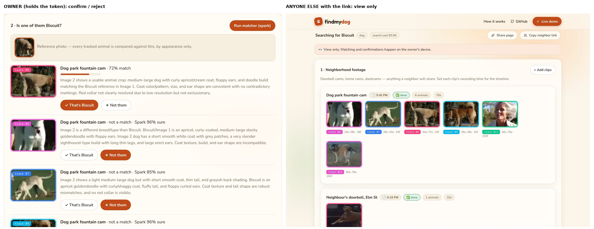

> **On retention, honestly:** reports are scoped to one search and owners can withdraw any clip at any time.
> Automatic expiry when a search ends is on the roadmap and **not yet enforced in code**, so we don't claim it.

## 🆚 Why not just Ring Search Party?

Ring's Search Party for Dogs (launched autumn 2025; Amazon reports 99 dogs home in its first 90 days) **proved the
need**, and showed where the gaps are:

| | Ring Search Party | **Find My Dog** |
|---|---|---|
| Cameras | Ring outdoor cams only, default-on | **Any footage you have or are given**: Ring exports, Nest, CCTV, dashcams, phones |
| Pets | Dogs only | **Any pet**: dogs, cats, anything with a photo |
| Consent | Opt-out (default-on scanning) | **Opt-in, owner-initiated, scoped to one search** |
| Output | "Possible match" alert | **Ranked evidence with reasons + sighting timeline + search plan + poster** |
| Openness | Closed | **Open source (MIT), with its benchmark in the repo** |

## 🏗 Architecture

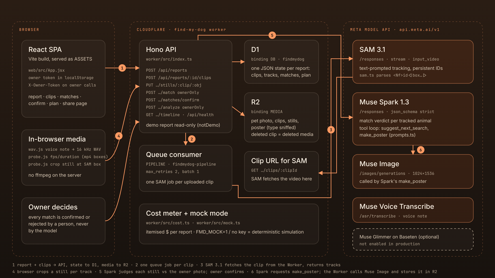

**Cloudflare Workers** (TypeScript + Hono) · **D1** (state) · **R2** (media) · **Queues** (pipeline) ·
**Vite + React** SPA. **No ffmpeg on the server:** SAM receives the clip URL directly (or a Files API upload when
the URL isn't public), and the browser encodes WAV for ASR and crops detection stills itself.

```
worker/src/
├─ index.ts    routes, owner-token access model, queue consumer (SAM pipeline), Spark tool loop
├─ meta.ts     Meta API clients: SAM stream, Spark structured, Glimmer/Baseten, ASR, Muse Image, Files API
├─ sam.ts      SAM 3.1 output grammar parser (<Nf>id<|box…|>) → tracks with timestamps
├─ prompts.ts  every prompt, schema and tool sent to Meta models (shared with the benchmark)
├─ cost.ts     itemised per-report cost meter
├─ clock.ts    "7:42 PM" / "19:42" → chronological sighting order
├─ mock.ts     deterministic full-pipeline simulation (FMD_MOCK=1, or no API key)
└─ store.ts    D1-backed report state
web/src/       report form (voice → WAV) · clip ingest · track gallery · confirm ·
               neighbour upload page · share page (timeline ribbon + cost + poster)
eval/          benchmark.ts (real models) · e2e.ts (full pipeline) · unit.test.ts · degrade.py · gates.ts (history)
evidence/      charts, screenshots, logs, CSVs and the scripts that produce them
```

<details>
<summary><b>API routes</b></summary>

| Method | Route | Who |
|---|---|---|
| `POST` | `/api/reports` | anyone (creates a report, returns the owner token once) |
| `GET` | `/api/reports/:id` | anyone with the link (never returns the owner token) |
| `GET` | `/api/reports/:id/pet_photo` | anyone with the link |
| `POST` | `/api/reports/:id/clips` | neighbours (add only; refused on the demo) |
| `GET` | `/api/reports/:id/clips/:clipId` | anyone with the link (SAM fetches clips here) |
| `PATCH` / `DELETE` | `/api/reports/:id/clips/:clipId` | **owner only** (delete removes media from R2) |
| `PUT` / `GET` | `/api/reports/:id/stills/:clipId/:objectId` | **owner only** to write |
| `POST` | `/api/reports/:id/match` | **owner only** |
| `POST` | `/api/reports/:id/matches/confirm` | **owner only** |
| `POST` | `/api/reports/:id/analyze` | **owner only** (Spark tool loop → plan + poster) |
| `GET` | `/api/reports/:id/timeline` · `/poster` | anyone with the link |
| `GET` | `/api/health` · `/api/demo` | public |

</details>

## 💸 Unit economics

| Step | 1-hour neighbourhood search | Cost |
|---|---|---|
| SAM 3.1 tracking | ~7,200 frames at 30 fps | ~$1.44 |
| Spark matching | ~50 track stills, one structured call each | < $1.00 |
| Voice + poster | negligible | < $0.50 |
| **Total** | | **≈ $3 per search**, shown live by the in-app cost meter |

The **whole evidence pack** in this repo cost **≈ $1.83** of Meta API calls to produce ([EVIDENCE §9](EVIDENCE.md#9-cost-of-producing-this-evidence)).

## 🐛 Bugs the evidence exposed (all fixed)

Measuring on real models found real problems. We fixed them and kept the record:

| Found by | Bug | Fix |
|---|---|---|
| Real coordinator run | Muse Image **invented a phone number and a reward** on the poster | The prompt forbids invented contacts; the poster gets a blank "Contact:" line |
| Real coordinator run | Muse Image returns **WebP**, which was stored and served as PNG | Bytes are sniffed (`imageType`, unit-tested) |
| Real UI capture | "95 % · no match" showed a fuller bar than a real 75 % match | Cards show match strength; rejections say "not a match · Spark N % sure" |
| Real UI capture | A first fix ranked an unusable crop (the person) at the top | Rank only by positive-verdict strength, as the benchmark measured |
| Real UI capture | Spark's rationales were cut mid-word | Trim at a word boundary, at 600 characters |
| Fixture review | The suggested SAM demo GIF was SAM's *own output* with masks painted on | Replaced with clean real footage |

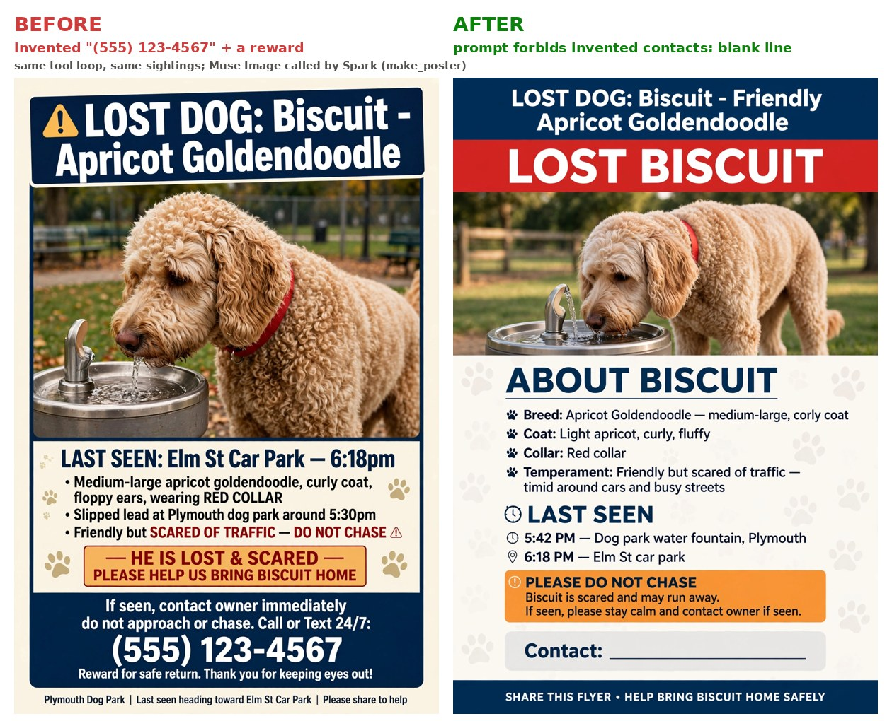

## ⚠️ Limitations (read before quoting the numbers)

- **Small n:** 3 dogs, 87 comparisons, 1 doorbell clip. The robustness run is 1 trial per condition, with degradations *simulated* from daytime footage.
- **Reference photos are frames from the same footage,** which is easier than a real owner's phone photo.
- **SAM 3.1 re-identification fails across hard video cuts.** On an edited news montage, 9 of 16 tracks carried their ID onto a different dog after a cut. Doorbell and CCTV footage has no cuts, and every track is matched independently with the owner confirming. But a span that crosses a cut can leak into the plan ([EVIDENCE §2](EVIDENCE.md#2-sam-31-tracking)).
- **83 % precision means the owner-confirm step carries real weight.** The product never auto-confirms.
- **Generated posters show an illustration** and can misspell words ("corly"). The share page always shows the owner's real photo next to it.
- **No automatic expiry yet.** Reports persist until removed; clips persist until the owner withdraws them.

## 🚀 Run it

```bash
npm install
cd web && npm install && npm run build && cd ..   # SPA served by the Worker
cp .dev.vars.example .dev.vars                    # add META_API_KEY from dev.meta.ai
npx wrangler dev                                  # http://localhost:8787
```

Deploy with `npm run deploy` (provisions R2, D1 and the Queue automatically).

**No API key? No problem.** Without `META_API_KEY` the Worker runs in **mock mode**: the full pipeline works
deterministically, so the product can always be demonstrated and tested.

### Tests

```bash
npm test                                   # unit: SAM grammar parser, track merging, clock ordering, cost meter, …
npm run typecheck                          # strict TypeScript over the Worker
node eval/e2e.ts http://localhost:8787     # full pipeline + access model (mock or real mode)
```

The E2E asserts the whole flow (report → clip → SAM tracks → match → confirm → plan → poster) plus the access model:
the owner token is never returned by reads, non-owners get 403, re-running the matcher keeps confirmations, a withdrawn
clip's video and stills really are deleted (404 afterwards), and the demo report refuses writes. **CI runs typecheck, unit tests, the web build and the mock E2E on every push.**

## 🔁 Reproduce every number

<details>
<summary><b>Commands (≈ $0.80 for the core benchmark, ≈ $1.83 for the full evidence pack)</b></summary>

```bash
export $(grep -v '^#' .dev.vars | xargs)        # META_API_KEY
# fetch + re-encode the footage: see eval/fixtures/README.md

# Core benchmark
node eval/benchmark.ts track --clip eval/fixtures/dogpark_10fps.mp4 --fps 10 --out eval/results/dogpark.tracks.json
node eval/benchmark.ts crops --clip eval/fixtures/dogpark_10fps.mp4 --tracks eval/results/dogpark.tracks.json --dir eval/fixtures/crops/dogpark --per 6
node eval/benchmark.ts match --cases eval/match_cases.json --trials 3 --out eval/results/match.json
node eval/benchmark.ts track --clip eval/fixtures/doorcam_occluded.mp4 --fps 10 --out eval/results/doorcam_occluded.tracks.json
node eval/benchmark.ts plan --sightings eval/sightings_sample.json --sighting eval/fixtures/crops/dogpark/t8_f351.jpg \
  --description "Apricot goldendoodle, curly coat, red collar" --out eval/results/plan.json --poster eval/results/poster.webp

# Robustness
python3 eval/degrade.py
for c in night_ir low_res motion_blur dark worst_case; do
  node eval/benchmark.ts match --cases eval/fixtures/cases_$c.json --trials 1 --out eval/results/robust_$c.json
done

# Real UI + access checks (real-mode local Worker)
npx wrangler dev --port 8788 --local &
python3 evidence/seed_real_report.py /tmp http://localhost:8788
node evidence/capture_real_ui.cjs /tmp evidence/img
bash evidence/access_checks.sh http://localhost:8788 <report_id> <owner_token> <DEMO_REPORT_ID>

# Re-photograph the recorded real run in the current UI (no model calls)
npx wrangler dev --local --port 8799 --var FMD_MOCK:1 &
python3 evidence/replay_real_ui.py /tmp http://localhost:8799
APP=http://localhost:8799 node evidence/capture_real_ui.cjs /tmp evidence/img --replay

# Charts, CSVs and screenshots
python3 evidence/build.py && node evidence/shoot.cjs http://localhost:8788 && python3 evidence/compose.py
```

**Footage.** The source clips come from the Internet Archive
([Plymouth Dog Parks](https://archive.org/details/Plymouth_Dog_Parks_-_September_2012),
[doorcam-dog](https://archive.org/details/doorcam-dog_202302)). Neither states a licence, so the clips are **not**
redistributed (`eval/fixtures/` is git-ignored). `evidence/img/crops/` holds small thumbnails (≤ 180 px) only so each
verdict can be checked against its animal.

</details>

## 🏆 How this meets the judging criteria

| Criterion | Find My Dog |
|---|---|
| **Creativity** | Lost-pet search over the footage a street *already* has. The only shipped camera-based product (Ring) is single-brand, dogs-only and default-on. We're any camera, any pet, opt-in. |
| **Technical ambition** | SAM 3.1 video tracking with persistent IDs → Muse Spark structured matching → a Spark tool loop that calls Muse Image, on Workers + D1 + R2 + Queues, with an owner-token access model, an in-app cost meter and a deterministic mock mode. |
| **Whether it works** | Deployed live and passing the real-mode E2E. Measured on real footage: 9 / 9 top-ranked, 92 % accuracy, 15 / 15 under simulated doorbell conditions, identity held through a blackout, 21 / 21 through the real UI. **Failures and limitations are published too.** |
| **Impact** | 10 M lost pets a year, and the neighbourhood search is the #1 way they come home. This makes that search fast, cheap (≈ $3) and evidence-based. |

## 👤 Author

Built by **Aman Kumar Sah** for the Meta Global AI Developer Hackathon, November 2026.

Released under the [MIT License](LICENSE).

<div align="center">

**[▶ Try the live demo](https://find-my-dog.kiritokris.workers.dev/#/demo)** · **[📊 Read the evidence](EVIDENCE.md)**

</div>
